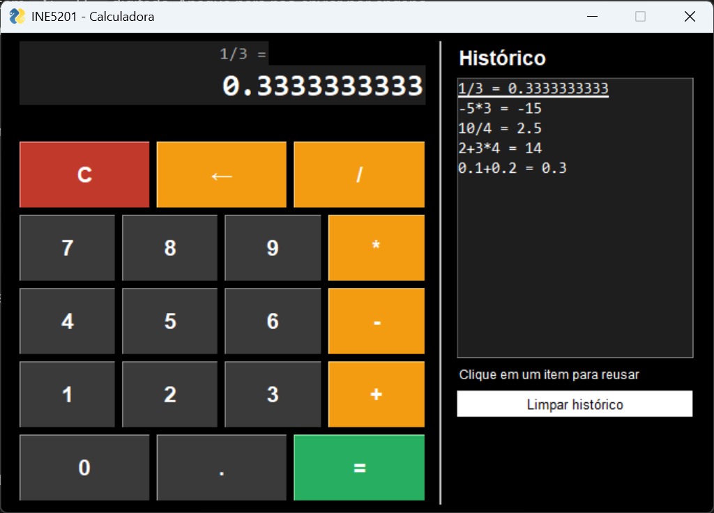
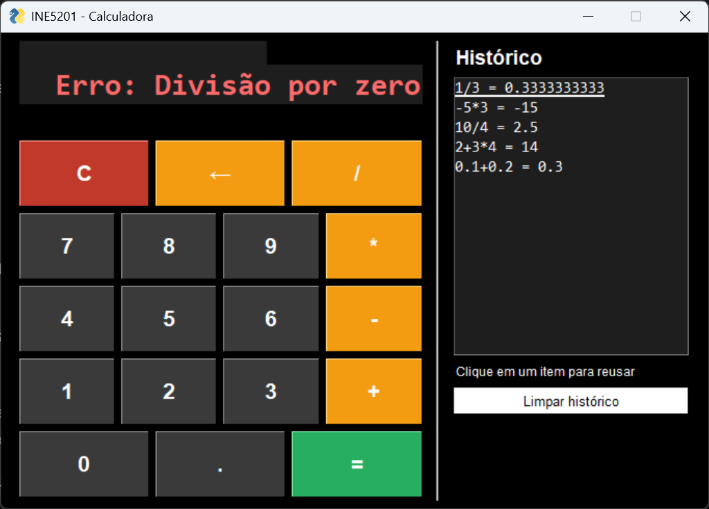

# Calculadora com Interface Gráfica

Tarefa 02 da disciplina **INE5201 - Introdução à Ciência da Computação com Python** (UFSC).

Calculadora em Python com interface gráfica feita em FreeSimpleGUI. Faz as 4 operações básicas com números decimais, trata erros como divisão por zero e expressões inválidas e guarda o histórico dos últimos cálculos.

## Dupla

| Nome | Matrícula |
|---|---|
| Matheus da Silva Farani | 24202994 |
| Paulo Ricardo Eliel Mendes Peres dos Santos | 24100434 |

## Como executar

Requisito: Python 3.10 ou mais recente.

```bash
pip install -r requirements.txt
python calculadora_gui.py
```

No Windows, se `python` não for reconhecido, use `py` no lugar.

## Como usar

Clique nos botões ou use o teclado:

| Tecla | Ação |
|---|---|
| `0` a `9` e `.` (ou `,`) | Digitar números |
| `+` `-` `*` `/` | Operações |
| `Enter` ou `=` | Calcular |
| `Backspace` | Apagar o último caractere (botão **←**) |
| `Esc` | Limpar o display (botão **C**) |

O histórico, à direita, mostra os 10 últimos cálculos. Clicar em um item coloca o resultado de volta no display, e o botão **Limpar histórico** apaga a lista.

## Funcionalidades

**Interface**
- Display com a conta anterior em cima e o número atual embaixo
- Botões 0-9, `.`, `+`, `-`, `*`, `/`, `=`, **C** e **←** no formato de calculadora física
- Cores por tipo de botão: números em cinza, operadores em laranja, **C** em vermelho e **=** em verde
- Histórico dos 10 últimos cálculos, com botão para limpar

**Cálculos**
- As 4 operações, com precedência: `2+3*4` dá `14`
- Números decimais e negativos (`-2.5*4`)
- Uso de `Decimal` em vez de `float`, para que `0.1+0.2` dê `0.3`
- Resultados arredondados em até 10 casas decimais (`1/3` dá `0.3333333333`)
- Depois de um resultado, um operador continua a conta e um número começa outra

**Tratamento de erros e validação**

| Situação | O que acontece |
|---|---|
| Divisão por zero (`8/0`) | Display mostra **Erro: Divisão por zero** |
| Expressão incompleta (`5+` e `=`) | Display mostra **Erro: Expressão inválida** |
| Resultado a partir de 1 quatrilhão (10^15) | Display mostra **Erro: Número muito grande** |
| Dois operadores seguidos (`5+*`) | O novo operador substitui o anterior (`5*`) |
| Operador no início | Só o `-` é aceito, para número negativo |
| Dois pontos no mesmo número (`5..`) | O segundo ponto é ignorado |
| Zeros à esquerda (`007`) | Viram `7` |
| Mais de 18 caracteres | A entrada é bloqueada e aparece um aviso |

## Estrutura do código

```
calculadora_gui.py
├── Constantes: operadores, limites, cores e mensagens de erro
├── Entrada no display
│   ├── numero_atual(expressao)
│   ├── adicionar_digito(expressao, digito)
│   ├── adicionar_ponto(expressao)
│   └── adicionar_operador(expressao, operador)
├── Cálculo
│   ├── separar_tokens(expressao) / converter_numero(texto)
│   ├── formatar_numero(valor)
│   └── calcular(expressao)
├── Interface gráfica
│   ├── criar_layout()
│   ├── atualizar_display(window, valor)
│   ├── tratar_erro(window, estado, mensagem)
│   ├── adicionar_ao_historico(window, historico, expressao, resultado)
│   ├── traduzir_evento(event)
│   └── processar_entrada(window, estado, historico, simbolo)
└── main(): loop de eventos da GUI
```

**Por que não usar `eval`.** O `eval` executaria qualquer código Python digitado. Em vez disso, `separar_tokens` transforma o texto em uma lista de números e operadores, por exemplo `['12.5', '+', '3']`, e `calcular` resolve a conta em duas passadas: primeiro `*` e `/`, depois `+` e `-`. Assim a precedência fica correta.

**Tratamento de exceções.** `calcular` não mostra mensagens: ela só lança `ZeroDivisionError`, `OverflowError` ou `ValueError`. Quem decide o que aparecer na tela é o `try/except` em `processar_entrada`, que chama `tratar_erro` com a mensagem certa para cada caso.

**Validação na entrada.** A maior parte dos erros é evitada antes do cálculo: `adicionar_operador` troca operadores seguidos, `adicionar_ponto` impede dois pontos no mesmo número e o limite de caracteres evita que o display transborde.

## Screenshots

**Calculadora com histórico**



**Tratamento de divisão por zero**



## Uso do GitHub Copilot

<!-- PREENCHER com o que vocês realmente fizeram no VS Code. -->

| Prompt | Função assistida | O que aproveitei ou mudei |
|---|---|---|
| "..." | | |
| "..." | | |
| "..." | | |

**Relato.** <!-- Um parágrafo: em quais funções o Copilot ajudou, uma sugestão aceita, uma corrigida ou descartada e por quê. -->

## Tecnologias

- Python 3
- [FreeSimpleGUI](https://pypi.org/project/FreeSimpleGUI/)
- `decimal` (biblioteca padrão do Python)
- GitHub Copilot
